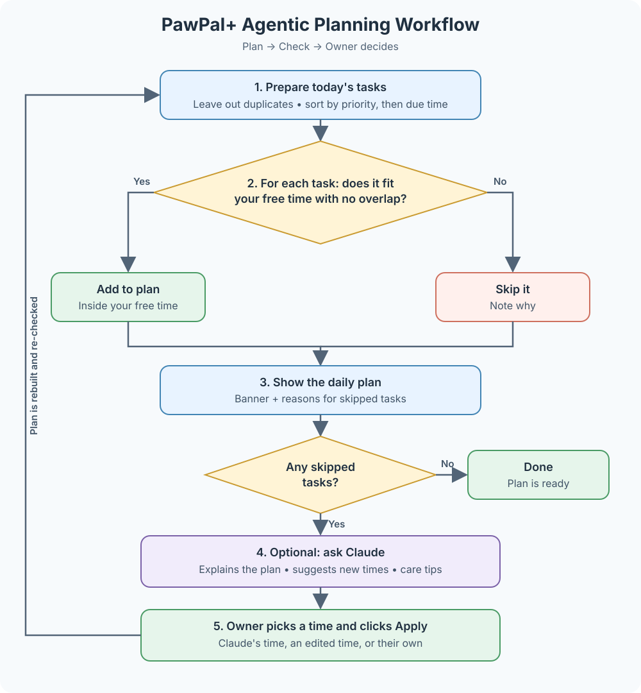

# PawPal+ (Final Project)

 **PawPal+** is a Streamlit app that helps a pet owner plan care tasks for their pets. The owner enters the times of day they're free, and a rule-based planning agent builds a daily schedule inside that free time. An optional Claude-powered coach explains the plan, suggests new times for tasks that didn't fit, and shares care tips. The owner approves every change.

## Scenario

A busy pet owner needs help staying consistent with pet care. **PawPal+** is an assistant that can:

- Track pet care tasks (walks, feeding, meds, enrichment, grooming, etc.) for several pets
- Plan around the owner's free time windows (for example 7:00–9:00 AM and 5:00–8:00 PM), task priority, due times, and overlapping tasks
- Produce a daily plan and explain why each task was scheduled or left out
- Catch duplicate tasks so the same care isn't planned twice
- Ask Claude to explain the plan and suggest new times for skipped tasks, which the owner can accept, edit, or ignore


<!-- ## What you will build

Your final app should:

- Let a user enter basic owner + pet info
- Let a user add/edit tasks (duration + priority at minimum)
- Generate a daily schedule/plan based on constraints and priorities
- Display the plan clearly (and ideally explain the reasoning)
- Include tests for the most important scheduling behaviors -->

## Getting started

### Setup

```bash
python -m venv .venv
source .venv/bin/activate  # Windows: .venv\Scripts\activate
pip install -r requirements.txt
```

### Add your Anthropic API key (optional)

The Claude features need an Anthropic API key. Without one, the app still works: the planner runs as usual, you can still reschedule tasks yourself, and the Claude section shows a built-in explanation instead.

1. Copy `.env.example` to `.env` in the project root.
2. Add your key on one line, with no quotes or spaces:

   ```
   ANTHROPIC_API_KEY=sk-ant-...
   ```

3. Optional: switch to a cheaper model by adding `PAWPAL_CLAUDE_MODEL=claude-haiku-5-5`. The default model is `claude-opus-5-5`.

`.env` is listed in `.gitignore`. Never commit it. Restart the app after editing `.env`, because the key is read when the app starts.

**Cost:** each click of **Get Claude's tips** makes one Claude call, about $0.01 with Opus or a small fraction of a cent with Haiku. To protect your credit, the app allows 5 Claude requests per browser session. Hover over the button to see how many are left, and refresh the page to start a new session.

Run the app:

```bash
python3 -m streamlit run app.py
```
<!-- ### Suggested workflow

1. Read the scenario carefully and identify requirements and edge cases.
2. Draft a UML diagram (classes, attributes, methods, relationships).
3. Convert UML into Python class stubs (no logic yet).
4. Implement scheduling logic in small increments.
5. Add tests to verify key behaviors.
6. Connect your logic to the Streamlit UI in `app.py`.
7. Refine UML so it matches what you actually built. -->

## Implementation Summary

PawPal+ turns pet care tasks into a daily plan. The code is split into three parts:

- **`pawpal_system.py` (rule-based core).** An `Owner` keeps track of `Pet` objects, and each pet manages its own `CareTask` objects. A task stores its due date and time, duration, priority, and recurrence. The `DailyScheduler` retrieves, sorts, and filters tasks. It also finds time conflicts and duplicate tasks, and finds which free window (if any) fully contains a task. The `SchedulePlanningAgent` leaves out duplicates, adds tasks in priority order only if they fit inside a free window and don't overlap, validates the final schedule, and records a reason for every task it leaves out. This file also parses and formats 12-hour times such as `9:20 AM`.
- **`ai_assistant.py` (Claude coach).** `ask_claude` sends a short summary of the finished plan to Claude, including the owner's free time windows. In one call, Claude returns structured JSON with an explanation of the plan, one suggested new date and time for each skipped task, and up to two care tips. Because everything comes from a single answer, the explanation and the suggested times can't disagree. Claude never edits the schedule itself. If there's no key, an API error, a refusal, or an unreadable answer, it falls back to a built-in explanation.
- **`app.py` (Streamlit UI).** Collects owner, pet, task, and free time input; shows the task list and the daily plan; and lets the owner reschedule skipped tasks, either by hand or starting from Claude's suggestion. Every applied change rebuilds the plan through the rule-based agent, so the result is always re-checked against the free time windows and for overlaps.

## Agentic Planning Workflow

Schedule generation uses a small agentic workflow integrated into the Streamlit
app. `SchedulePlanningAgent`:

1. Leaves out duplicate tasks: same pet, same title (ignoring capital letters), same due date and time, and same frequency.
2. Orders the remaining due tasks by priority, then due time, with `DailyScheduler`.
3. Considers tasks in that order, adding a task only when it starts and finishes
   inside one of the owner's free time windows and does not overlap the current plan.
4. Continues considering later tasks after skipping one, so every task gets a chance
   to fit.
5. Validates the final plan and tells the owner why any due task was left out:
   outside their free time, or overlapping a higher-ranked task. A banner above
   the plan sums this up, for example "1 task of 3 fit your plan. Left out: 2 tasks
   overlapping another task."

After the plan is built, the owner can bring in Claude, with a human check before
anything changes:

6. **Get Claude's tips.** One Claude call returns why the plan works, a suggested
   new date and time for each skipped task, and up to two care tips. Tips never
   mention times, so new times appear in only one place.
7. **Owner decides.** Under **Reschedule skipped tasks**, Claude's suggested time is
   filled in for each skipped task. The owner can apply it, change it first, or
   ignore it. Without Claude, they can enter a new date and time themselves.
8. **Plan is re-checked.** When the owner clicks **Apply**, the task is updated, the
   rule-based agent rebuilds the plan, and the result is shown in place: now in the
   plan, still doesn't fit (with the reason), or moved to another day.

Neither the planner nor Claude changes task times without the owner's approval,
and neither makes veterinary decisions. Claude only explains and suggests. The
rule-based agent decides the final schedule and re-checks every applied change.
If the plan changes after Claude answers, the old answer is hidden so it can't
mislead. Tests cover overlap resolution, free time windows, duplicate detection,
and the Claude integration (using a fake client, so tests spend no API credit).

The diagram below shows the full workflow: the rule-based planning steps, the
optional Claude call, and the owner's review and Apply loop. Its Mermaid source is
[`diagrams/agentic_planning_workflow.mmd`](diagrams/agentic_planning_workflow.mmd).



## Design Decisions

| Decision | Why | Trade-off |
|---|---|---|
| The rule-based planner decides the schedule; Claude only advises | The plan is always valid (inside free time, no overlaps) and fully testable. A bad AI answer can't break it. | Claude can't rearrange the whole day; it only suggests new times for skipped tasks. |
| The owner approves every change with **Apply** | The owner stays in control, and the planner re-checks every applied change. | One extra click per task. |
| One structured Claude call (explanation, one time per skipped task, tips) | Tips and suggested times can't disagree. They did when they came from two separate calls. It also halves the cost, and the app can read the times reliably. | Claude's answer has a fixed shape, and tips aren't allowed to mention times. |
| Free time windows instead of a minutes budget | It matches real life (free before work and after work), and the planner can say exactly why a task didn't fit. | The owner has more to enter, and a task must fit fully inside one window. |
| Fall back to a built-in explanation when Claude is unavailable | The app keeps working with no key, an API error, or a refusal. | The fallback text is generic. |

## 🖥️ Sample Output

Real app output for owner Jordan with one free window, 9:00 AM–11:00 AM. Luna's
walk, feed, and play are all due at 9:00 AM (20 minutes each), and the walk was
accidentally added twice.

### 1. Your tasks

```
Pet   Task  Due                 Status
Luna  walk  2026-11-17 9:00 AM  Incomplete
Luna  w̶a̶l̶k̶  2026-11-17 9:00 AM  Duplicate
Luna  feed  2026-11-17 9:00 AM  Incomplete
Luna  play  2026-11-17 9:00 AM  Incomplete

Some tasks are duplicates (crossed out above). They are left out of the schedule;
remove them to clean up your list.
~~Luna: walk 2026-11-17 9:00 AM~~ — same as walk at 9:00 AM   [Remove duplicate]
```

### 2. Generate schedule

```
Your free time: 9:00 AM–11:00 AM  (Total free time: 2 hr 0 min)

1 task of 3 fit your plan. Left out: 2 tasks overlapping another task. See the
reasons below, and reschedule them under Ask Claude for tips.

Daily plan for Jordan
- 9:00 AM — Luna: walk (20 min, high priority, daily)
  Why it's scheduled: It is due at 9:00 AM on 2026-11-17. The planner considers
  higher-priority tasks first, then earlier due times, and avoids overlapping
  tasks. It fits inside your 9:00 AM–11:00 AM free window.

Tasks needing more time or rescheduling
Luna: feed — due 2026-11-17 9:00 AM
  Overlaps Luna's walk. The planner kept the higher-ranked task; change one due
  time to schedule both.
Luna: play — due 2026-11-17 9:00 AM
  Overlaps Luna's walk. The planner kept the higher-ranked task; change one due
  time to schedule both.

Left out as duplicates (remove them under Your tasks):
- Luna: walk at 9:00 AM. Duplicate of Luna's walk at 9:00 AM; it was left out so
  the task is not done twice.
```

### 3. Get Claude's tips

This is Claude's answer for this plan from a live API call:

```
Why this plan works
Jordan's only free window is 9:00 AM to 11:00 AM, and all three of Luna's tasks
were due at 9:00 AM, so they collided. The planner kept the high-priority walk at
9:00 AM and skipped the medium-priority feed and low-priority play. Only 20 of the
120 budgeted minutes were used, so there is plenty of room to fit both skipped
tasks later in the window.

Reschedule skipped tasks
Claude's suggested time is filled in. Change it if you like, then click Apply.
Luna: feed — now 2026-11-17 9:00 AM
  Claude suggests 2026-11-17 9:30 AM — Starts after the walk ends, giving Luna a
  short rest before eating.
  [New date: 2026-11-17] [New time: 9:30] [AM]  [Apply]
Luna: play — now 2026-11-17 9:00 AM
  Claude suggests 2026-11-17 10:30 AM — Fits inside the free window and leaves
  digestion time after feeding.
  [New date: 2026-11-17] [New time: 10:30] [AM]  [Apply]

Tips
- Let Luna cool down and settle after her walk before serving her meal.
- Avoid vigorous play right after eating to lower the risk of stomach upset.

1131 input + 313 output tokens · about $0.0108 · Claude requests this session: 1/5.
```

### 4. Owner clicks Apply for feed

```
✓ Luna: feed moved from 2026-11-17 9:00 AM to 2026-11-17 9:30 AM — now in your plan.

2 tasks of 3 fit your plan. Left out: 1 task overlapping another task.

Daily plan for Jordan
- 9:00 AM — Luna: walk (20 min, high priority, daily)
- 9:30 AM — Luna: feed (20 min, medium priority, daily) · rescheduled from 9:00 AM
```

Play's suggestion (10:30 AM) stays filled in, ready to apply.

## Testing Summary

**Reliability summary:** 25 of 25 automated tests pass (19 scheduler, 6 Claude with a fake
client). In 3 live Claude calls I checked by hand, all 5 suggested times were valid: none
overlapped another task, and the 4 made with free windows all fit inside them. The AI
struggled when the tips and the suggested times came from two separate calls: they gave
different times (9:20 vs 9:30 AM) until I combined them into one structured call. One
early live call also failed (the API rejected part of the request format), which the
fake-client tests hadn't caught.

### Guardrail results

| Guardrail | What it prevents | Checked by |
|---|---|---|
| Planner decides, Claude only advises | A bad AI answer breaking the schedule | Design, plus headless app runs |
| Owner must click **Apply** | Changes nobody approved | Headless app runs |
| Re-check after **Apply** | A suggested time that still clashes being scheduled (shown as "still doesn't fit" instead) | Headless app run |
| Drop past or malformed times | Invalid suggestions reaching the owner | Automated test |
| Fallbacks: no key, refusal, unreadable answer | The app breaking when Claude isn't available | Automated tests, plus the no-key CLI run |
| Refusal fallback model (Opus) | A declined request giving no answer | In the code, but never triggered in testing |
| Hide outdated answers | An explanation about an older plan misleading the owner | Headless app run |
| 5-request limit | Accidental spending | Headless app run (resets on refresh, so it's a soft limit) |
| Duplicate detection | The same task being planned twice | Automated tests |
| Free-window validation | Overlapping or backwards windows | Automated test |

### How to run

Run the test suite from the project root:

```bash
python -m pytest
```

To run only the PawPal scheduler tests, or only the Claude coach tests:

```
python -m pytest tests/test_pawpal.py
python -m pytest tests/test_ai_assistant.py
```

### What's tested

- **Scheduler (`tests/test_pawpal.py`, 19 tests):** task completion, chronological
  sorting, daily and weekly recurring occurrences, conflict detection, the planning
  agent's overlap and time-budget handling, free time windows (tasks must fit fully
  inside a window; windows can't overlap or end before they start; overlap checks
  still apply inside a window), duplicate detection (including the cases that are
  *not* duplicates: same title at a different time, a different pet, or a
  completed task), and strict `H:MM` + AM/PM time parsing.
- **Claude coach (`tests/test_ai_assistant.py`, 6 tests):** the plan summary sent
  to Claude (including free time windows), one call returning the explanation,
  suggested times, tips, and cost, dropping past or malformed suggested times, and
  falling back when there's no API key, Claude refuses, or the answer can't be
  read. These tests use a fake client, so they make no API calls and cost nothing.

Test output:

```
============================= test session starts ==============================
platform darwin -- Python 3.9.6, pytest-8.4.2, pluggy-1.6.0
collected 25 items

tests/test_ai_assistant.py ......                                        [ 24%]
tests/test_pawpal.py ...................                                 [100%]

============================== 25 passed in 0.25s ==============================
```

### What worked

- All 25 automated tests pass in under a second.
- The Claude tests use a fake client, so they're fast, free, and repeatable, and they cover
  every fallback (no key, refusal, unreadable answer, past or malformed times).
- Streamlit's headless test runner was used to click through real app flows without a
  browser: adding tasks, generating a plan, applying new times, duplicates, and the
  request limit.
- A few live Claude calls (about $0.01 each) confirmed the suggested times land inside the
  free windows and match the tips.

### What didn't work at first

| Problem | How it was found | Fix |
|---|---|---|
| The API rejected `maxItems` in the JSON schema (400 error) | First live call. The fake-client tests had passed. | Removed it; the prompt asks for the right number, and the code pads or trims the list. |
| Duplicate tasks weren't crossed out | Seen in the browser. The headless test only checked that the style was set. | Used Unicode strikethrough characters, which the table does display. |
| Claude's tips and suggested times disagreed (9:20 vs 9:30 AM) | Noticed while using the app | Combined them into one structured Claude call. |
| A green "Plan checked" banner showed even when a task was outside the free time | Noticed while using the app | The banner now counts each reason a task was left out, and is green only if nothing was. |
| The same Claude answer kept repeating after the request limit | Noticed while using the app | Answers about an older plan are hidden, and the limit message is clearer. |
| AM/PM was cut off to "A…" | Seen in the browser | Smaller text for just that dropdown. |

### What I learned

- A fake client tests my code, not the real API. When the request format changes, at least
  one live call is still needed.
- Headless UI tests check what data is on the page, not how it looks. Some problems only
  show up in a real browser.
- Each piece of information should come from one place. Two Claude calls produced two
  different answers.
- Test the messages the user reads, not just the logic. A misleading success message is a bug.
- Keeping Claude as an advisor, with the rule-based planner re-checking every change, means
  an AI mistake can't produce an invalid plan.

**Confidence Level:** ⭐⭐⭐⭐☆ (4/5). All 25 tests pass, covering the scheduler,
the planning agent, free time windows, duplicate handling, time input, and the
Claude integration. The Streamlit UI was checked with Streamlit's headless test
runner, and the live Claude call was checked by hand. The tests can't judge the
quality of Claude's wording, and they don't cover every UI interaction.

## Smarter Scheduling

| Feature | Method(s) | How it works |
|---------|-----------|--------------|
| Collect tasks for an owner | `Owner.get_all_tasks`, `DailyScheduler.get_tasks` | Returns each task paired with the pet it belongs to. |
| Sort tasks | `DailyScheduler.sort_tasks_by_due_date`, `DailyScheduler.sort_by_time` | Sorts by full due date/time or by time of day alone. |
| Filter tasks | `DailyScheduler.filter_tasks_by_completion_status`, `DailyScheduler.filter_tasks_by_due_status` | Filters by completion, or selects incomplete tasks that are due today, upcoming, or overdue. |
| Recurring due dates | `CareTask.is_due_on` | Determines whether one-time, daily, or weekly tasks occur on the selected date. |
| Build a daily plan | `DailyScheduler.build_daily_schedule` | Prioritizes high- to low-priority tasks, then earlier due times; skips tasks that exceed the available minutes. |
| Detect time conflicts | `DailyScheduler.find_time_conflicts` | Finds overlapping task durations on the selected date, including across pets and recurring tasks. The app and CLI demo display a warning rather than stopping. |
| Detect duplicate tasks | `DailyScheduler.find_duplicate_tasks` | Flags an incomplete task with the same pet, title (ignoring capital letters), due date/time, and frequency as an earlier one. The app crosses it out, blocks adding exact copies, and leaves duplicates out of the plan. |
| Free time windows | `DailyScheduler.find_free_window`, `validate_free_windows`, `format_window` | Finds the free window that fully contains a task on the plan date; rejects windows that overlap or end before they start; formats windows as `7:00 AM–9:00 AM`. |
| Plan, validate, and explain | `SchedulePlanningAgent.create_plan` | Leaves out duplicates, adds tasks in priority order only if they fit a free window and don't overlap, validates the result, records a reason for every skipped task, and counts tasks left out for each reason. |
| Create recurring occurrences | `CareTask.mark_complete` | When an attached daily or weekly task is completed, adds its next occurrence. |
| Validate task details | `CareTask.__post_init__` | Requires positive duration, an allowed priority, and an allowed frequency. |
| 12-hour time input | `parse_clock_time`, `format_clock_time` | Accepts only `H:MM` (hour 1–12, two-digit minutes) plus AM/PM, and formats times as `9:30 AM` throughout the app. |
| Explain the plan and suggest new times | `ai_assistant.ask_claude` | One Claude call returns structured JSON: an explanation, one suggested date and time per skipped task (past or malformed times are dropped), and up to two care tips. Falls back to a built-in explanation if Claude is unavailable. |

## Demo Walkthrough

1. Edit the owner name and add pets with their species.
2. Add tasks with a title, duration, priority, frequency, due date, and due time.
   For the time, pick from the dropdown (5-minute steps) or type a time like `9:20`
   and press Enter, then choose AM or PM. Exact duplicates are blocked when you add them.
3. Review **Your tasks**. Filter or sort the list, and mark tasks complete. Any
   duplicates are crossed out and can be removed with **Remove duplicate**.
4. Under **Build Schedule**, choose a date and set **Your free time**. It starts with
   one window (7:00–9:00 AM); edit it, use **Add window** for more, or **Remove** one.
5. Select **Generate schedule**. The banner says how many tasks fit and why any were
   left out. The daily plan explains each scheduled task, and **Tasks needing more
   time or rescheduling** lists each skipped task with its reason.
6. Under **🤖 Ask Claude for tips**, select **Get Claude's tips** to see why the plan
   works, a suggested new time for each skipped task, and care tips.
7. Under **Reschedule skipped tasks**, keep Claude's suggested time or change it
   (enter one yourself),
   then click **Apply**. The plan rebuilds immediately, the result appears in place,
   and moved tasks are marked "rescheduled from …" in the daily plan.
8. Run the CLI example to see sorting, completion status, duplicate detection,
   conflict warnings, and a plan built inside free time windows, with a reason for
   every task left out. By default it doesn't call Claude, so it needs no API key.
   Add `--claude` to also send the plan to Claude (one API call, about a cent).

Run the CLI example with:

```bash
python main.py
```

Sample output from a run on November 17, 2026:

```
Tasks in insertion order:
- 2026-11-18 7:00 AM Mochi: Feed (incomplete)
- 2026-11-17 8:00 AM Mochi: Walk (completed)
- 2026-11-18 8:00 AM Mochi: Walk (incomplete)
- 2026-11-17 9:00 AM Mochi: Walk (incomplete)
- 2026-11-17 9:00 AM Mochi: walk (incomplete)
- 2026-11-17 5:30 PM Luna: Play (incomplete)
- 2026-11-17 9:00 AM Luna: Breakfast (incomplete)
- 2026-11-17 12:00 PM Luna: Brush (incomplete)

Tasks sorted by date and time:
- 2026-11-17 8:00 AM Mochi: Walk
- 2026-11-17 9:00 AM Mochi: Walk
- 2026-11-17 9:00 AM Mochi: walk
- 2026-11-17 9:00 AM Luna: Breakfast
- 2026-11-17 12:00 PM Luna: Brush
- 2026-11-17 5:30 PM Luna: Play
- 2026-11-18 7:00 AM Mochi: Feed
- 2026-11-18 8:00 AM Mochi: Walk

Completed tasks:
- Mochi: Walk

Incomplete tasks:
- Mochi: Feed
- Mochi: Walk
- Mochi: Walk
- Mochi: walk
- Luna: Play
- Luna: Breakfast
- Luna: Brush

Duplicate tasks:
- Mochi: walk at 9:00 AM (same as Mochi's Walk)

WARNING: Time conflict: Mochi's Walk overlaps Luna's Breakfast.

Free time: 7:00 AM–10:00 AM, 5:00 PM–8:00 PM

Today's Schedule for Jordan (2 pets): 2 of 4 tasks fit
- 9:00 AM Mochi: Walk (30 min, high priority, once)
- 5:30 PM Luna: Play (20 min, low priority, daily)

Left out:
- Luna: Breakfast at 9:00 AM. Overlaps Mochi's Walk. The planner kept the higher-ranked task; change one due time to schedule both.
- Luna: Brush at 12:00 PM. Doesn't fit inside your free time (7:00 AM–10:00 AM, 5:00 PM–8:00 PM). Move it into a free window or add more free time.
- Mochi: walk at 9:00 AM. Duplicate of Mochi's Walk at 9:00 AM; it was left out so the task is not done twice.

Tip: run `python main.py --claude` to also ask Claude to explain this plan.
```

To also try Claude from the command line (needs `ANTHROPIC_API_KEY` in `.env`):

```bash
python main.py --claude
```

After the plan, it prints Claude's answer. Real output from that run:

```
Asking Claude (claude-opus-5-5)...

Why this plan works:
Mochi's high-priority Walk took its 9:00 AM due time inside your morning free window, so it won the slot over Luna's medium-priority Breakfast that was due at the same time. Luna's Play fit neatly at 5:30 PM in your evening window. Luna's Brush was due at 12:00 PM, outside both free windows, so it was skipped even though plenty of time budget remains.

Suggested new times:
- Luna: Breakfast (now 9:00 AM) -> 2026-11-17 8:30 AM. Fits the morning window and finishes before Mochi's 9:00 AM Walk.
- Luna: Brush (now 12:00 PM) -> 2026-11-17 6:00 PM. Inside the evening window, after Luna's Play ends at 5:50 PM.

Tips:
- Serve Luna's breakfast before heading out so she isn't waiting while Mochi is walked.
- Brush Luna gently in short strokes and reward her with a treat to keep grooming positive.

1207 input + 331 output tokens, about $0.0114
```

Without an API key, `--claude` prints the built-in explanation instead.

## Reflection

This project taught me that AI works best here as an advisor inside a system with firm
rules, not as the decision-maker. The rule-based planner keeps every schedule valid and
testable, while Claude adds what rules can't: plain-language explanations and sensible
suggestions. I also learned that solving problems with AI means checking its output the
way a user would. Several bugs only showed up when I used the app in a browser or made a
live API call, not in the automated tests, and fixing the cause (one Claude call instead
of two) worked better than patching the symptoms.

My responsible-AI reflection (how I collaborated with AI, a suggestion I accepted and one
I rejected, and the system's limitations) is in [model_card.md](model_card.md).
